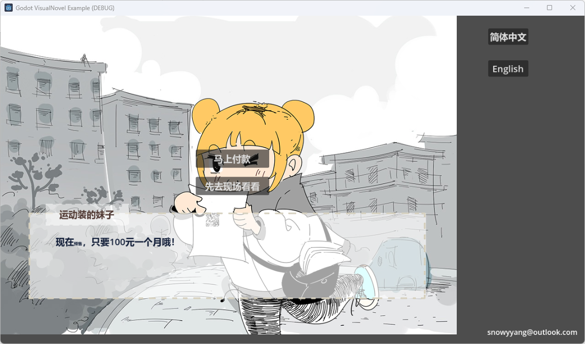

# Godot VisualNovel Example

A simple visual novel example developed using Godot.

## Features
* Basic scenes, character portraits, text, voice acting, and background music
* Choices, variable, looping
* Simple animation effects
* Multi-languages
* Text history
* TODO:
  - Responsive UI

## About
* **Program**: [Snowy](mailto:snowyyang@outlook.com)
* **Story**: [Snowy](mailto:snowyyang@outlook.com)
* **Art**: [黑翼大魔](mailto:1727569463@qq.com)
* **Vocals**: 酱子鸭 (female), 极夜 (male)
* **Music**: Arcy Cadence
* **Localization**: Kottalo

## License
* **Project**: [GPL-3.0](/LICENSE)
* **Assets**
  - **Art** (*.jpg* / *.png*): [CC-BY-SA-4.0](/LICENSE.txt) (黑翼大魔)
  - **Voices** (*.ogg*): [CC-BY-SA-4.0](/LICENSE.txt) (酱子鸭，极夜)
  - **Music / Sound Effects** (*BGM_\*.ogg*, *.wav*): [CC-BY-SA-4.0](/LICENSE.txt) (Arcy Cadence)
  - **Text** (*.csv*): [CC-BY-SA-4.0](/LICENSE.txt) (Kottalo)
